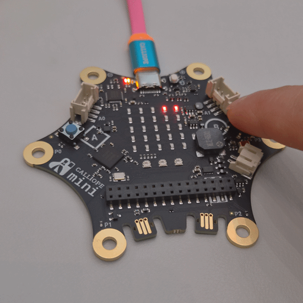

# Snake for Calliope mini v3

A classic **Snake** game for the 5×5 LED matrix of the [Calliope mini v3](https://calliope.cc/), written in C++ with the Arduino framework.



## Features

- **Two-button steering:** A turns left, B turns right, relative to the snake's current direction
- **Blinking target** so it stands out from the snake body
- **Growing snake** with self-collision detection
- **Wrap-around edges:** leaving the board on one side brings you back on the other
- **Animated opening screen**
- **Game over and win screens** with final score

## Controls

| Input    | Action                                  |
|----------|-----------------------------------------|
| A or B   | Start the game on the opening screen    |
| Button A | Turn left                               |
| Button B | Turn right                              |

**Goal:** eat as many targets as possible. Filling all 25 LEDs wins the game.

## Hardware & Software

- [Calliope mini v3](https://calliope.cc/)
- [Arduino IDE 2](https://www.arduino.cc/en/software) with Calliope mini board support
- [Calliope Arduino library](https://github.com/calliope-edu/Calliope_Arduino_library), which installs its dependencies:
  [Adafruit GFX](https://github.com/adafruit/Adafruit-GFX-Library), BLEPeripheral and Adafruit NeoPixel

## Getting Started

1. Install the Calliope mini board support and the **Calliope Arduino library** in the Arduino IDE
   (follow the [instructions](https://calliope.cc/en/coding/editors/arduino) from the official Calliope website).
2. Clone this repository:
   ```bash
   git clone https://github.com/zsamora/calliope_snake.git
   ```
3. Open `calliope_snake/calliope_snake.ino` in the Arduino IDE.
   The Arduino IDE requires the sketch file and its folder to have the same name.
4. Connect the Calliope mini via USB, select the board and port, and click **Upload**.
5. Press A or B to start playing.

## How It Works

The game runs as a simple **game loop**: read input → move the snake → draw, repeated every `SNAKE_SPEED_MS` milliseconds.

**Snake body.** The body is stored in two arrays, `sx[]` and `sy[]`. On every step, each segment moves to the position of the segment in front of it, and the head moves to its new position (based on the direction and turn). To grow, the length is increased *before* the shift, so the old tail stays in place.

**Directions and turning.** The four directions (North, East, South, West) are numbered (0, 1, 2, 3), and each direction is mapped to a step on the board through `DX[]` and `DY[]`. Turning left or right uses modular arithmetic, while adding 4 keeps the value non-negative:

```cpp
direction = (direction + turn + 4) % 4;
```

**Wrap-around edges.** The same idea moves the head across the board edges:

```cpp
int nx = (sx[0] + DX[direction] + SIZE) % SIZE;
```

**Self-collision.** Before the snake moves, the new head position is checked against the body. When the snake is not eating, the tail leaves its square in the same step, so the last segment is excluded from the check.

**Responsive buttons.** While waiting for the next step, the buttons are checked every few milliseconds.

## Code Structure

`calliope_snake.ino` is organized in sections, and every function is defined before it is used:

| Section              | Functions                                                                                          |
|----------------------|----------------------------------------------------------------------------------------------------|
| Shared functions     | `isPressed`, `collidesWithSnake`                                                                   |
| Opening screen       | `waitOrButtonPressed`, `buildSpiralBody`, `spiralAnimation`, `gameStartAnimation`, `openingScreen` |
| Game setup           | `setTarget`, `newGame`                                                                             |
| Game loop            | `setTurnFromButtons`, `drawGame`, `waitTick`, `gameOver`, `step`                                   |
| Arduino              | `setup`, `loop`                                                                                    |

## Future Ideas

- [ ] Non-blocking scrolling title for the opening screen
- [ ] Ring buffer for the snake body instead of shifting the array
- [ ] Sound effects with the built-in speaker
- [ ] Use the RGB LEDs of the Calliope mini v3 for game feedback

## License

This project is licensed under the [MIT License](LICENSE).

## Author

**Benjamín Zamora (zsamora)** · [GitHub](https://github.com/zsamora) · [LinkedIn](https://www.linkedin.com/in/benjamin-zamora-56980b236)
